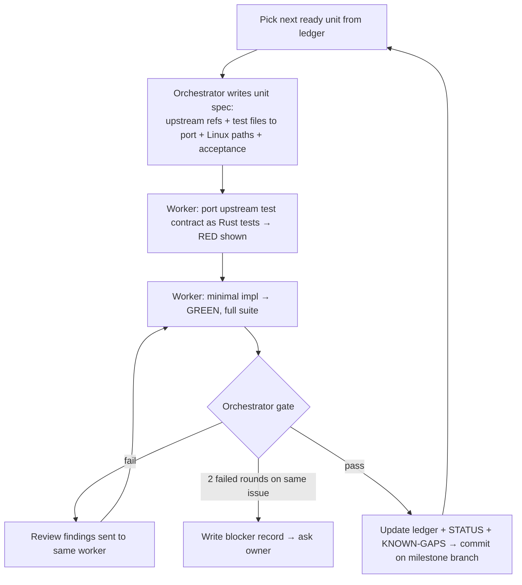

# Parity roadmap — full Mole feature set, rebuilt for Linux

Status: **DRAFT, awaiting owner approval** (2026-10-19). Supersedes nothing; M1 ([M1-analyzer.md](M1-analyzer.md)) is done.
Upstream pin: `tw93/Mole` @ `8c55e8c07f3b34eeeb0352753b660f823468cd43` (v1.61.0). Local checkout used for this plan: `/tmp/mole-upstream-review-20261019` (disposable; re-clone at the pin if missing).
License basis: GPL-3.0-only — porting upstream logic is allowed; credit `tw93/Mole` + file path in a comment on ported logic ([decision](../decisions/2026-10-19-v1-scope.md)).
Target host: Omarchy/Arch, x86_64, **root fs = btrfs** (verified 2026-10-19 via `findmnt`).

> "Reverse engineer" here = source port. Upstream is open source (Bash + Go); `rea` binary tooling is not needed for the CLI. `rea` is reserved for (a) inspecting our own release binary in M10, and (b) the closed-source Mole native apps, which are **out of scope** (their features aren't in the CLI source; see review limits).

## 1. Parity definition

Every upstream feature gets exactly one disposition. The live tracking table is [PARITY-LEDGER.md](PARITY-LEDGER.md).

| Disposition | Meaning | Done when |
|---|---|---|
| **Port** | Same behavior, Linux paths | Upstream test contract ported to Rust and green |
| **Adapt** | Same user intent, Linux-native mechanism | Linux contract tests green + live run on host |
| **Replace** | macOS-only target swapped for a Linux equivalent of similar value | Same as Adapt, plus rationale in ledger |
| **Drop** | No sensible Linux meaning or unacceptable risk | Ledger row with reason; nothing shipped |

Command surface target (upstream router `mole` L303–435, flags from `bin/*.sh`):

| Upstream | Linux command | Disposition | Key flags to carry |
|---|---|---|---|
| `mo` (menu) | `<bin>` no args → TUI menu | Port | `--debug` |
| `mo analyze` | `analyze [PATH]` | Port (M1 done; parity gaps M2) | `--json` |
| `mo status` | `status` | Adapt (/proc, sysfs) | `--json`, `--watch --interval` |
| `mo clean` | `clean` | Adapt (XDG + Linux tool caches) | `--dry-run --categories --select --exclude --external --whitelist` |
| `mo purge` | `purge` | Port (dev artifacts are OS-neutral) | `--dry-run --paths --include-empty --yes` |
| `mo installer` | `installer` | Adapt (`.deb/.rpm/.AppImage/.pkg.tar.zst/.iso/.tar.*/.zip` in Downloads) | `--dry-run --max-depth --hidden --type` |
| `mo uninstall` | `uninstall` | Replace (pacman/AUR/Flatpak/AppImage/.desktop instead of `.app`/Homebrew) | `--dry-run --list --permanent --whitelist` |
| `mo optimize` | `optimize` | Replace (narrow Linux task catalog, six-state outcomes ported) | `--dry-run --whitelist` |
| `mo history` | `history` | Port | `--json --limit` |
| `mo completion` | `completion` | Port (generate bash/zsh/fish; rc edit only with `--dry-run` preview) | `--dry-run` |
| `mo update` / `remove` | — | Drop for packaged installs; self-update only for non-package installs, decided in M10 | |
| `mo touchid` | — | **Drop** (PAM/auth changes outside a cleanup tool; see lifecycle research) | |

## 2. Closed loop — how every work unit runs



### Unit spec template (orchestrator fills; lives at `plans/units/<id>.md`)

- **Upstream refs:** functions + file:line at the pin, and upstream test files whose contracts must be ported.
- **Linux mapping:** exact paths (XDG-resolved), owner tool, privilege, recovery mode (`regenerate` / `trash` / `owner-native` / `irreversible`).
- **Non-targets:** what must never be touched (from upstream protection rules + Linux additions).
- **Acceptance:** named tests + live-run script.
- **Boundaries:** files the worker may change; deps allowed.

### Orchestrator gate (must all pass; orchestrator runs them, never trusts the envelope)

1. `cargo fmt --check && cargo clippy --all-targets -- -D warnings && cargo test` — full output read.
2. Red evidence: worker's envelope names the failing run; orchestrator spot-checks by reverting impl hunk mentally/by `git stash`-free diff review that tests would fail without it.
3. Hostile-input pass on the diff (global AGENTS.md list): sizes `try_from`, path validation, cleanup on error paths, no silent error swallow.
4. **Sandbox live run** for anything mutating: `HOME=$(mktemp -d)` + XDG vars pointed inside, seeded by `tests/fixtures/` builders; run the real binary through tmux; diff the fixture tree before/after. **Never** run a mutating command against the real `$HOME` until its unit is accepted, and then only `--dry-run` first with owner present.
5. Parity check: ledger row's upstream test list fully ported (or each omission justified).
6. Ledger, STATUS checkpoint, KNOWN-GAPS updated; commit (Conventional, atomic) on the milestone branch.

### Loop exits

- Unit: gate passes. Milestone: all its ledger rows Done + milestone live script passes. Project: every row Done/Dropped + M10 release gate.
- Stop rule: same failure twice → blocker in `docs/agent-context/blockers/`, ask owner. No third variation.

### Worker protocol

Superset, Codex `gpt-6-luna` medium (fast tier requires `service_tier="priority"`, not passable via CLI — see HANDOFF). One worker per milestone branch/workspace; parallel workers only for units with disjoint files (marked ∥ below). Envelope: `SUPERSET_WORKER_DONE` / `BLOCKED` as in M1.

## 3. Target architecture

```
src/
  main.rs            arg routing → commands (std parsing until clap approved)
  core/
    paths.rs         XDG resolution (honors XDG_* env), home, physical-path resolution
    policy.rs        protected paths, whitelist (port lib/core/app_protection + whitelist.sh concepts)
    validate.rs      validate_path_for_deletion port (absolute, no .., no control bytes, symlink-ancestor checks, critical roots)
    sink.rs          THE ONLY deletion code: mode = Trash | Permanent | DryRun; identity recheck (dev,ino,mtime) at sink;
                     freedesktop Trash (same-fs $topdir/.Trash-$uid or ~/.local/share/Trash) with .trashinfo
    oplog.rs         session + per-item records (port lib/core/history.sh semantics, bounded loading)
    outcome.rs       six-state outcome enum (port lib/optimize/outcomes.sh)
    proc.rs          "is owner running?" via /proc scan; Unknown is distinct
    units.rs         SI vs IEC formatting (port internal/units/bytes.go conventions)
  scan.rs            M1 scanner (+ progressive/parallel in M2)
  rules/             versioned candidate catalog: each rule = evidence, non-targets, owner check, recovery
  adapters/          pacman, yay, docker, journal, coredump, flatpak(probe), npm/pnpm/bun/uv/cargo/go/gradle/mise...
  commands/          analyze, status, clean, purge, installer, uninstall, optimize, history, completion, menu
  tui/               shared widgets: list+select, confirm, progress, summary (ratatui)
tests/
  fixtures/          builders for sandbox HOME trees (never real paths)
```

Invariant (ported from upstream audit `scripts/audit_destructive_sinks.py`): **no `remove_*`/`rename` outside `core/sink.rs`**. Enforced by a test that greps `src/` (M3).

## 4. Milestones

Dependencies: M2 ∥ M3 → M4 → (M5 ∥ M6 ∥ M7) → M8 → M9 → M10. Status (M2) can run in parallel with anything after M3 starts, since it's read-only.

### M2 — Analyze parity (read-only)  *(deps: M1)*
Upstream: `cmd/analyze/{live_scan,scanner,model,update,view,json,cache,cleanable,insights}.go`.
- M2.1 Progressive scan: paint immediate children first, stream sizes (live_scan.go). Bounded parallel workers (std threads; cap from upstream: 12 entry traversal).
- M2.2 Overview mode (no path): Home, XDG cache/data/state, `/var/cache/pacman/pkg`, `/var/log/journal`, `/var/lib/docker` (read-only, unreadable → Unavailable), Trash. Linux replacement for Home/Library/Applications overview.
- M2.3 Top large files view (bounded heap, 20), filter `/`, multi-select (no delete yet), refresh `r`, back history.
- M2.4 `--json` (needs **serde/serde_json approval**) — same model, `scan_status` complete/partial/unavailable.
- M2.5 Cleanable hints: `CACHEDIR.TAG` (regular file, not symlink), known artifact basenames — hint only.
- M2.6 Btrfs note: show "shared/snapshot space not counted" banner when fs is btrfs; no extent math yet.
- Port tests: `scanner_test.go`, `cleanable_test.go`, JSON shape tests. Acceptance: `analyze` on `/` overview + `~` in release build ≤ 1.5× `du -sx` wall time (measured, recorded).

### M3 — Safety core  *(deps: M1; blocks everything mutating)*
Upstream: `lib/core/file_ops.sh` (`validate_path_for_deletion`, `safe_remove`, `mole_delete` L2367+), `cmd/analyze/delete.go`, `lib/core/history.sh`, `docs/SECURITY_DESIGN.md`.
- M3.1 `paths.rs` + `validate.rs` — port `tests/path_validation_fuzz.bats`, `file_ops_safe_remove_symlink.bats`, `core_safe_functions.bats` contracts. Plus fuzz-style table tests (control bytes, `..`, symlinked ancestors, `/`, `$HOME`, `/usr`, bind-mount roots).
- M3.2 `sink.rs` — freedesktop Trash spec (info/ + files/, collision-safe names via `RENAME_NOREPLACE` through rustix, cross-fs → refuse Trash, offer Permanent explicitly). Identity recheck at sink. Port `file_ops_mole_delete.bats`, `user_file_ops.bats`.
- M3.3 `oplog.rs` + `history` command — `~/.local/state/<bin>/operations.log` + deletions TSV (escaped controls), bounded tail loading (fixes upstream unbounded read). Port `history.bats`.
- M3.4 Whitelist: `~/.config/<bin>/whitelist`, glob semantics as upstream `manage_whitelist.bats`.
- M3.5 Sink-uniqueness test (grep invariant). `proc.rs` owner-running probe with Unknown.
- M3.6 Wire analyze delete: select → confirm (paths, not indexes) → Trash via sink. Port `delete_test.go`.
- Gate extra: adversarial tests — symlink swap between preview and sink, path replaced by dir, file on other mount, unreadable parent, non-UTF-8, cancellation mid-batch.

### M4 — Clean framework + user essentials  *(deps: M3)*
Upstream: `bin/clean.sh` (`_safe_clean_impl` L774–1020, sections), `lib/clean/user.sh`, `lib/clean/caches.sh`.
- M4.1 Rule catalog + section runner: categories, `--dry-run` preview tree, `--select/--categories/--exclude`, summary with per-item outcome and honest totals (allocated, dedup), cancellation summary (`clean_summary_cancel.bats`).
- M4.2 User essentials (Adapt): Trash emptying (explicit, own row), `~/.cache/thumbnails`, user logs (`~/.local/state/*/log` only when rule evidence), coredumps via `coredumpctl` (owner-native), incomplete downloads (`*.part`, `*.crdownload` older than N days + not open).
- M4.3 Browser caches (Adapt; owner-running guard each): Chromium/Chrome/Brave/Edge/Vivaldi `~/.cache/<browser>`, Firefox `~/.cache/mozilla/firefox/*/cache2`, old Chromium versions where applicable. Never profiles/cookies/sessions. Port `clean_browser_versions.bats`, `browser_clones.bats` intent.
- M4.4 Project caches: `__pycache__` with tracked-file + nested-repo guards (port `lib/clean/caches.sh` project cache logic).
- Live: sandbox HOME seeded with every target + non-target; real `$HOME` `--dry-run` only, owner reviews output.

### M5 — Dev tool caches ∥  *(deps: M4)*
Upstream: `lib/clean/dev.sh` (5,465 lines; functions listed in ledger). Each tool = one unit, owner-native command preferred, guarded by owner-running probe:
npm, pnpm (store prune, `is_safe_pnpm_store_path`), bun, corepack, uv (`uv cache dir` query), pip, cargo (registry cache only; sources/git preserved per upstream), go (`go clean -cache`, if present), gradle (daemon guard), maven, mise, conda, JetBrains logs/old versions, AI agent/editor caches that exist on Linux (Codex CLI, Claude, Cursor/VS Code `CachedData`, obsolete extensions), automation browsers (Playwright/Puppeteer caches), docker (**advisory only**: `docker system df` report; build-cache prune only with explicit select; never volumes), nix (absent here → Unavailable).
Port tests: `clean_dev_caches.bats`, `dev_extended.bats`, `clean_corepack.bats`, `clean_ai_cli_caches.bats`, `clean_automation_browsers.bats`, `clean_developer_state.bats`.

### M6 — Linux system owners ∥  *(deps: M4; first sudo use)*
Replaces upstream `lib/clean/system.sh` (Time Machine, macOS installers, system caches).
- M6.1 Privilege model: never run as root; per-action `sudo` invocation of the owner tool only, consent once, dry runs need no sudo (port `manage_sudo.bats` intent).
- M6.2 pacman cache via `paccache -dk3` preview / `-rk3` apply; uninstalled-package cache `-ruk0`. AUR helper cache (`~/.cache/yay`) build dirs.
- M6.3 journald: `journalctl --disk-usage`, vacuum by size/time (archived only; explain active files).
- M6.4 Orphan packages: **report only** (`pacman -Qdtq`), never auto-remove.
- M6.5 Flatpak unused refs (probe; absent here → Unavailable, tests with fake binary on PATH).
- M6.6 Btrfs/snapper awareness: list snapshots read-only and explain retained space; no deletion.
- Owner tools are tested via fake executables on a test PATH that record argv; live run on host with `--dry-run`, then one real apply with owner present.

### M7 — Purge + installer ∥  *(deps: M3)*
- M7.1 Purge (Port): `MOLE_PURGE_TARGETS`, project-root detection (`is_purge_project_root`, rails/go/php/dotnet helpers), `purge_artifact_has_authored_content`, nested/protected filtering, activity classification (recent → unselected), final remove guard, config paths file. Port `purge.bats` (incl. root replacement L2585), `purge_config_paths.bats`, `purge_menu_pty.py` as TUI test.
- M7.2 Installer (Adapt): Downloads/Desktop/configured roots; Linux types; bounded depth + cumulative budget; identity revalidation; Trash default. Port `installer.bats`, `installer_zip.bats`, `installer_fd.bats`.

### M8 — Uninstall (Replace)  *(deps: M3, M6.1)*
Upstream concept: app inventory → personal-data review (kept by default) → batch removal with shared-owner checks (`lib/uninstall/*`, 3,161-line batch.sh).
- Inventory sources: pacman explicit pkgs (+ AUR via `pacman -Qm`), Flatpak apps, AppImages in common dirs, user `.desktop` entries.
- Removal via owner: `sudo pacman -Rns <pkg>` (preview `-Rnsp`), `flatpak uninstall` (never implicit `--delete-data`), AppImage → Trash.
- Leftovers: XDG dirs matching app id/name variants (port `uninstall_naming_variants.bats`), shared-root protection (port `uninstall_safety.bats` — shared XDG roots, Steam libraries, credentials), surviving-owner recheck (`remove_file_list`). Personal data unselected by default.
- `--list`, by-name args, interactive selector (port `uninstall_menu_pty.py`, `uninstall_review_pty.py`).

### M9 — Status + optimize + menu + completion
- M9.1 Status (Adapt): CPU/load/per-core (`/proc/stat`), mem/swap/PSI (`/proc/meminfo`, `/proc/pressure`), disks (statvfs + `/proc/self/mountinfo`, pseudo-fs filtered), disk I/O (`/proc/diskstats`), net (`/proc/net/dev`), battery/thermal (`/sys/class/power_supply`, `/sys/class/thermal`), top processes + persistent high-CPU alert (PID+PPID+cmd identity, 100%/5min default), zombies. Unknown modeled explicitly (fixes upstream zero-as-unknown). `--json`, `--watch` NDJSON with warm collector.
- M9.2 Optimize (Replace): port catalog validation + six-state outcomes + exclusions; Linux tasks (each needs own justification, all dry-runnable): font cache refresh (`fc-cache`), desktop/mime database refresh, failed systemd user units report, `fstrim` status report, journal health. No network/auth/permission changes. Port `optimize_catalog.bats`, `optimize_outcomes.bats`, `optimize_summary.bats`.
- M9.3 Interactive menu (port `main_menu_pty.py`, `menu_search_pty.py`), terminal restore on signals (port `menu_trap_restore.bats`, timeout TTY tests intent).
- M9.4 Completion generation bash/zsh/fish (port `completion.bats`; clap_complete if clap approved).

### M10 — Release
- Rename (TRADEMARK.md), LICENSE text, README with honest scope, `--version`.
- Arch PKGBUILD (AUR), `cargo build --release` reproducibility, GitHub Actions: fmt/clippy/test + SHA256SUMS + build provenance (upstream release.yml model).
- `rea` pass over the release binary: confirm no unexpected deletion syscalls outside sink symbols, strings audit (no hardcoded dev paths/secrets).
- Full parity ledger review: every row Done/Dropped with evidence.

## 5. Approval gates (owner decides; worker must BLOCK, not assume)

| When | Decision |
|---|---|
| M2.4 | Add `serde` + `serde_json` (JSON output, oplog) |
| M9.4 (or earlier) | Add `clap` + `clap_complete`, or keep std parsing |
| M6 start | First `sudo` use; owner present for first real apply |
| Any unit | Any dep beyond approved list |
| M10 | Final name, publish to GitHub/AUR |

## 6. Risks

- dev.sh breadth (5k lines, ~180 functions): many targets are macOS apps. Ledger triages per function; expect ~40% Drop.
- Btrfs: Trash on same subvolume frees nothing until emptied; snapshots retain extents — every summary must say "space freed: measured statvfs delta", never sum of sizes.
- Race safety: identity recheck narrows but doesn't eliminate TOCTOU; use `openat`/`unlinkat` relative to a held dir fd where feasible (rustix) — design in M3.2.
- Worker drift: big units → split until a unit fits one worker turn (~≤400 LOC diff).
