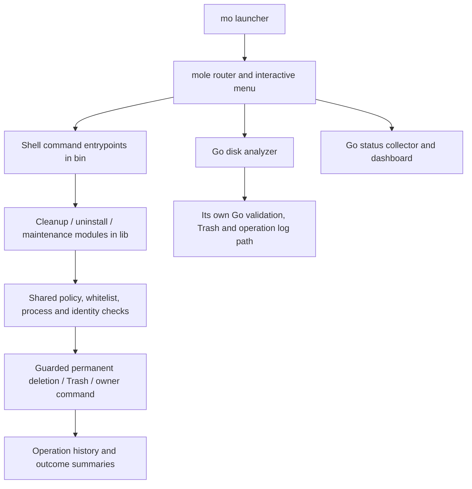

# Mole upstream context and Linux product opportunities

Research date: 2026-10-19. Status: source investigation and proposals, not an approved implementation plan.

## Resume and evidence boundary

Reviewed upstream `tw93/Mole` main at commit [`8c55e8c07f3b34eeeb0352753b660f823468cd43`](https://github.com/tw93/Mole/tree/8c55e8c07f3b34eeeb0352753b660f823468cd43), obtained by a shallow clone. Local research checkout: `/tmp/mole-upstream-review-20261019` (disposable; use the pinned links to resume). There were **323 tracked paths**. No `.codegraph/` directory was present; no index was created.

This is a repository-wide architecture and product review: complete tracked-file inventory, command/module mapping, deeper inspection of critical cleanup and deletion flows, and test-contract inspection. It is **not a line-by-line security audit of every file** or a claim that every test body was read. Tests, translated READMEs, assets, and contributor/agent tooling received different depths of inspection. The inventory is [upstream-file-inventory.txt](upstream-file-inventory.txt). Subsystem reports give their own coverage:

- [Analyzer and status](upstream-analyzer-status.md).
- [Lifecycle, maintenance, packaging, and CI](upstream-lifecycle-maintenance.md).
- [Linux opportunities and primary Linux references](linux-opportunities.md).

No upstream installer, cleanup, uninstall, optimization, or purge command was executed. No macOS runtime or full upstream test suite was available/validated. Source contracts are evidence of intended/implemented logic, not proof of race freedom or runtime correctness. The Windows branch, private native Mac/Windows applications, full Git history, and all issue/PR discussions are outside this snapshot review. The public README distinguishes the CLI from the separate native applications; do not ascribe those applications' advertised catalogs or UI to this source tree. [Source](https://github.com/tw93/Mole/blob/8c55e8c07f3b34eeeb0352753b660f823468cd43/README.md).

## Verdict

Build an independent Linux storage tool that helps users understand **ownership, recovery consequences, and actual space pressure**. Mole already sets a substantial baseline for safety, terminal UX, developer cleanup, and machine-readable inspection. A Rust rewrite or a larger list of delete patterns does not establish superiority.

Initial recommendation: Omarchy/Arch first, read-only scan and candidate explanations first, then one reviewed cleanup workflow. Broader distributions, uninstall, container mutation, and filesystem snapshot management should require their own evidence and tests. All recommendations below remain proposals.

## Existing Mole architecture

The Go analyzer has a separate deletion implementation; it does not invoke the shell deletion funnel. Both must be considered when learning safety rules. The shell stack also has intentionally annotated exceptions and owner-command mutation boundaries. [Router](https://github.com/tw93/Mole/blob/8c55e8c07f3b34eeeb0352753b660f823468cd43/mole), [shell safety](https://github.com/tw93/Mole/blob/8c55e8c07f3b34eeeb0352753b660f823468cd43/lib/core/file_ops.sh), [Go deletion](https://github.com/tw93/Mole/blob/8c55e8c07f3b34eeeb0352753b660f823468cd43/cmd/analyze/delete.go).

| Area | Role and important consumers | Linux implication |
|---|---|---|
| `mole`, `mo`, `lib/core/commands.sh` | Router, menu, command catalog; early history dispatch | Reuse interaction concepts; define a single Rust command contract |
| `bin/clean.sh`, `lib/clean/` | Sections, candidate filtering/sizing, user/browser/dev/system/app cleanup | Rebuild target evidence for Linux rather than translating paths |
| `lib/core/` | Shared shell policy, app identity/protection data, file operations, timeout, logging, privilege and UI helpers | Preserve contracts; macOS bundle catalogs are not Linux ownership evidence |
| `bin/uninstall.sh`, `lib/uninstall/` | Installed app inventory, personal-data review, batch removal, Homebrew and surviving-owner checks | Linux package databases and sandbox scopes need separate designs |
| `bin/purge.sh`, `lib/clean/project.sh`, `purge_shared.sh` | Project discovery, artifact protection, selection, activity checks, final guard | Developer artifacts are a useful early feature, but name/age alone are insufficient |
| `bin/installer.sh` | Bounded archive discovery, selection and identity-bound removal | User downloads need explicit review; no generic old-download deletion |
| `bin/optimize.sh`, `lib/optimize/` | Catalog of bounded macOS maintenance tasks and truthful outcome states | Avoid generic Linux “optimization”; add only measured, owner-supported tasks |
| `cmd/analyze/` | Interactive explorer, scanning/cache/live results, JSON, snapshots, Trash | Read-only Linux scanner is a realistic first milestone |
| `cmd/status/` | Health/metrics collection, TUI, JSON/NDJSON and process diagnostics | Useful later; avoid duplicating a full system monitor before cleanup works |
| `lib/manage/`, `install.sh`, Nix files | Update/removal ownership, verification, config, packaging | Prefer native distribution ownership; do not overwrite packaged installs |
| `tests/`, Go tests, `scripts/`, workflows | Regression/fuzz/PTY tests, source audits, build/release gates | Adopt adversarial filesystem fixtures and behavioral tests from the start |

Upstream is Bash plus Go, not one self-contained native binary. `go.mod` uses Bubble Tea/Lip Gloss for terminal interfaces and gopsutil for metrics. The reviewed Makefile's release targets build Darwin amd64/arm64. Nix packaging is not evidence of Linux compatibility. [Manifest](https://github.com/tw93/Mole/blob/8c55e8c07f3b34eeeb0352753b660f823468cd43/go.mod), [Makefile](https://github.com/tw93/Mole/blob/8c55e8c07f3b34eeeb0352753b660f823468cd43/Makefile), [package](https://github.com/tw93/Mole/blob/8c55e8c07f3b34eeeb0352753b660f823468cd43/package.nix).

## Features already present: baseline, not differentiators

| Workflow | Verified source behavior | Important limit |
|---|---|---|
| Clean | Known caches/logs/temp leftovers; browser, language/tool and app-specific cleanup; whitelist and preview | Real cleanup permanently removes targets; default home Trash emptying is intentional |
| Uninstall | App selection/by-name removal; shared-owner checks; personal data kept by default with explicit selection | Trash is default; `--permanent` exists; Linux package ownership is a different problem |
| Analyze | Navigable TUI, filters/multi-selection, large files, JSON, bounded scanning/cache, confirmed Trash | Partial/unavailable scans are explicit; completeness is within exclusions, not an atomic snapshot |
| Status | CPU/memory/disk/network/power/process metrics; JSON and NDJSON watch; process alerts | Collectors can be partial/stale; Darwin-specific probes remain |
| Purge | Many build/dependency artifact types, project grouping, custom roots, worktree artifacts, Git protections | Recent/unknown activity defaults unselected; permanent removal; worktrees themselves preserved |
| Installer | Recognized installer/archive types, known roots, cumulative scan budget, selection and identity revalidation | Archive suffix alone is not enough; discovery failures can abort the list |
| History | Run/session attribution, structured JSON and action logs | It is an audit history, not an automatic restore transaction |
| Maintenance | Explicit task catalog, dry run, exclusion rules and outcome accounting | Finder/DNS/database/macOS service semantics do not carry over wholesale |

Sources: [clean orchestration](https://github.com/tw93/Mole/blob/8c55e8c07f3b34eeeb0352753b660f823468cd43/bin/clean.sh), [Trash cleanup](https://github.com/tw93/Mole/blob/8c55e8c07f3b34eeeb0352753b660f823468cd43/lib/clean/user.sh), [uninstall review](https://github.com/tw93/Mole/blob/8c55e8c07f3b34eeeb0352753b660f823468cd43/lib/uninstall/review.sh), [purge targets](https://github.com/tw93/Mole/blob/8c55e8c07f3b34eeeb0352753b660f823468cd43/lib/clean/purge_shared.sh), [installer](https://github.com/tw93/Mole/blob/8c55e8c07f3b34eeeb0352753b660f823468cd43/bin/installer.sh), [history](https://github.com/tw93/Mole/blob/8c55e8c07f3b34eeeb0352753b660f823468cd43/lib/core/history.sh), plus the subsystem reports.

## Cleanup flow traced in source

`bin/clean.sh` rejects inherited root before sourcing user state, loads common/sudo and cleanup modules, and loads the invoking user's whitelist. `start_cleanup` settles privilege consent before cleanup probes. `perform_cleanup` runs bounded sections: optional system; user essentials; caches; browsers; cloud/office; developers; utilities; virtualization; support logs; leftovers/services; Apple-specific caches; firmware/backups; large-file and artifact guidance. Some rows are read-only recommendations, not removals. Sources: [clean](https://github.com/tw93/Mole/blob/8c55e8c07f3b34eeeb0352753b660f823468cd43/bin/clean.sh), [user module](https://github.com/tw93/Mole/blob/8c55e8c07f3b34eeeb0352753b660f823468cd43/lib/clean/user.sh).

`safe_clean` / `safe_clean_guarded` share `_safe_clean_impl`: skip absent targets; filter protection, whitelist and compiled models; normalize nested candidates; measure under budgets; collect preview or perform guarded removal; account for successful/partial outcomes. `classify_cleanup_risk` is a description/path heuristic used in debug output, not a proof of safe deletion. [Implementation](https://github.com/tw93/Mole/blob/8c55e8c07f3b34eeeb0352753b660f823468cd43/bin/clean.sh#L774-L1020).

The core `validate_path_for_deletion` rejects empty/relative/traversal/control-byte paths, normalizes policy paths, checks leaf and ancestor symlink effects, protects critical roots, applies live-user-cache/SQLite/download checks, and enforces app/data policy with specific system-cache exceptions. `safe_remove` honors the whitelist even when called outside `safe_clean`. `mole_delete` adds deletion mode, optional expected identity/hash/absence checks, recoverable routing and audit outcomes. Privileged removal refuses mutable ancestors rather than trusting a prior path check. [Validator and sinks](https://github.com/tw93/Mole/blob/8c55e8c07f3b34eeeb0352753b660f823468cd43/lib/core/file_ops.sh).

Owner commands need equal scrutiny. For example, uv queries its actual configured cache root before pruning; Go has root/process guards; Cargo sources/git stores are deliberately preserved; Docker daemon-managed data is advisory by default; Nix garbage collection preserves generations. Never interpret an available package-manager command as automatically safe or exactly previewable. [Developer cleanup](https://github.com/tw93/Mole/blob/8c55e8c07f3b34eeeb0352753b660f823468cd43/lib/clean/dev.sh), [recovery rules](https://github.com/tw93/Mole/blob/8c55e8c07f3b34eeeb0352753b660f823468cd43/.claude/rules/clean-dev.md).

## Safety lessons to retain

- Unknown is a distinct outcome, not “not running”, “not installed”, “empty”, or “zero bytes”. Incomplete inventory must not authorize orphan deletion. Cancellation must remain cancellation through wrappers and worker pools.
- Preview is evidence for review, not lasting authority. Recheck object, parent, owner/activity, protection and relevant content at the final mutation boundary. A check-then-path-delete sequence still needs race analysis; Rust does not remove those races automatically.
- Authored data, tool sessions, credentials, live SQLite families, deployment keys, nested repositories and shared stores must stay protected even if a directory name looks disposable. “Can download again” and “can reconstruct exactly” differ.
- Keep bounded concurrency, scan deadlines, no publication of failed discovery, terminal restoration, safe filename rendering, and honest incomplete/error summaries.
- Keep deletion implementations few and auditable. Upstream audits raw deletion annotations, duplicate helpers, ineffective assertions and timeout-code usage, alongside Bats, Go, fuzz and PTY tests. Presence of tests is not execution evidence.

Sources: [security design](https://github.com/tw93/Mole/blob/8c55e8c07f3b34eeeb0352753b660f823468cd43/docs/SECURITY_DESIGN.md), [current audit](https://github.com/tw93/Mole/blob/8c55e8c07f3b34eeeb0352753b660f823468cd43/SECURITY_AUDIT.md), [core rules](https://github.com/tw93/Mole/blob/8c55e8c07f3b34eeeb0352753b660f823468cd43/.claude/rules/core.md), [purge rules](https://github.com/tw93/Mole/blob/8c55e8c07f3b34eeeb0352753b660f823468cd43/.claude/rules/purge-installer.md), [audit scripts](https://github.com/tw93/Mole/tree/8c55e8c07f3b34eeeb0352753b660f823468cd43/scripts).

## Proposed Linux advantages, in priority order

These are product hypotheses, not implemented features or measured superiority claims. Linux-specific coverage is an advantage for Linux users, not a defect in a macOS product.

| Priority | Proposed capability | User benefit | Necessary boundary |
|---|---|---|---|
| First | Explain every candidate: owner, exact rule/evidence, recovery method, activity/inspection status, bytes and uncertainty | User can understand why it is offered and why another item stays | Ownership labels must distinguish confirmed from inferred/unknown; risk labels alone are insufficient |
| First | One reviewed plan for supported direct-file actions, revalidated before application | User approves concrete targets; changed targets are refused | A saved plan is untrusted input, not permission; owner-wide GC cannot promise a fixed exact file list |
| First | Linux-native cache inventory with package rollback retention | Keep useful Arch package versions while identifying expendable ones | Use owner-supported APIs/tools; package removal and orphan packages require separate approval/scope |
| Next | Explain “disk full” beyond directory totals: blocks, available space, inode exhaustion, deleted-open files | Find cases another cache sweep cannot resolve | Read-only diagnosis; do not kill/restart services or truncate files automatically |
| Next | Filesystem-aware accounting: hardlinks, sparse files, Btrfs shared extents/snapshots, mount boundaries | Avoid promising 20 GB freed from 20 GB of logical files | Mark exact reclaimable bytes unknown when unprovable; no snapshot deletion by default |
| Next | Recovery-aware execution and per-run receipts for explicitly supported actions | Clear restore route and visible irreversible actions | Trash/quarantine on the same filesystem retains space; package/container GC often cannot be undone |
| Later | Docker/Podman/Flatpak scope-aware inventory and narrowly selected native cleanup | Explain build cache/runtime space without touching user volumes | Verify context, user/system/rootless scope and native mutation semantics; no blanket system prune |
| Later | Developer workflow awareness and local growth comparisons | Rank inactive build artifacts and explain what grew | Preserve worktrees, ignored private files, model weights and offline dependencies; stored scans can be stale |

Primary Linux basis: [XDG directory roles](https://specifications.freedesktop.org/basedir/latest/) distinguish caches from config/data/state; [unlink semantics](https://man7.org/linux/man-pages/man2/unlink.2.html) explain hardlinks and deleted-open space; [statvfs](https://man7.org/linux/man-pages/man3/statvfs.3.html) exposes block and inode availability. Docker documents separate object pruning and data-loss consequences for volumes; prefer read-only inventory until per-object semantics are designed. [Docker reference](https://docs.docker.com/engine/manage-resources/pruning/). Btrfs, pacman, Flatpak, journal and recovery references are in [linux-opportunities.md](linux-opportunities.md).

An XDG cache root is a location convention, not blanket deletion authority. Linux apps can place mixed data there. Existing upstream features such as JSON, audit logs, worktree guards, CACHEDIR.TAG handling, partial scans and APFS clone accounting must not be advertised as inventions here.

## Proposed roadmap and acceptance gates

1. **Read-only foundation.** Confirm actual host/filesystems and Rust toolchain; choose CLI/TUI behavior and explicit scan roots. Inventory mount boundaries, allocated/apparent bytes, links and scan completeness. No sudo or deletion. Acceptance: sandbox fixtures for sparse files, hardlinks, symlinks, unreadable entries, unusual/non-UTF-8 names, cancellation and mount exclusions; compare measured output against platform tools with clearly stated units and exclusions.
2. **Explainable candidates.** A small versioned rule catalog; begin with measured user cache/build targets and read-only Arch package cache inventory. Each rule defines positive evidence, non-targets, owner/activity checks and recovery costs. Acceptance: target/non-target fixtures, tracked/nested repository protection, active/unknown-owner cases, no model/session/credential deletion candidates, measured value on representative systems.
3. **One reviewed execution workflow.** Choose one supported direct-file rule; unify review and execution candidate selection; revalidate at the sink; emit per-action receipts and explicit recovery mode. Acceptance: red-first race/substitution/permission/interruption tests, hostile path/size input tests, real CLI review flow and full applicable Rust checks. No general atomic/undo guarantee across unrelated actions.
4. **Native integrations.** Add Arch cache retention and journal/container/Flatpak support one owner at a time after exact preview, privilege and mutation semantics are documented. Extend distro support through explicit tested capabilities, not a single distribution-name switch.
5. **Differentiation after measurement.** Add Btrfs explanation, deleted-open/inode diagnosis, growth reports and recovery UX based on actual user storage problems. Benchmark scans before claiming speed or Rust performance advantages.

This is sequencing guidance for scope discussion. It does not authorize dependencies, privilege escalation, live cleanup, packaging, publication, or implementation. Before coding, write the agreed executable plan and tests into the owning context records.

## Avoid for the initial release

No automatic package orphan removal, old-kernel deletion, snapshot/generation deletion, worktree deletion, broad `~/.cache` wipe, database vacuuming, model purge, automatic service restart, generic “optimize”, AI deletion decisions, plugin execution system or background daemon. Each adds correctness or trust surface before the basic storage workflow is established. This is an MVP recommendation, not a permanent prohibition.

## Naming and code reuse: source facts, decision pending

Upstream's [LICENSE](https://github.com/tw93/Mole/blob/8c55e8c07f3b34eeeb0352753b660f823468cd43/LICENSE) declares GPL-3.0. Its [TRADEMARK.md](https://github.com/tw93/Mole/blob/8c55e8c07f3b34eeeb0352753b660f823468cd43/TRADEMARK.md) explicitly asks forks to use their own name/icon and not use Mole branding for a competing product. The local Rust manifest currently says MIT and the project name is `mole-linux`. These facts need a branding and code-reuse decision before release. No upstream implementation was copied into local product code during this research. Whether any future reuse requires a licensing change needs explicit review; “rewrite in Rust” alone is not a licensing conclusion.

## Current local state and remaining decisions

Local product remains the six-file Rust scaffold; this research only adds context documents. At the beginning of this investigation neither `cargo` nor `rustc` resolved on PATH. No code was implemented or tested. Older Omarchy version claims were not reverified in this task.

Decide: initial user and concrete storage problem; Arch-only first release; first read-only command; first cleanup target and recovery policy; terminal interface; naming/reuse direction. Recommended discussion starting point: a developer on Arch/Omarchy who wants to understand and recover space without damaging active projects or rollback options.
